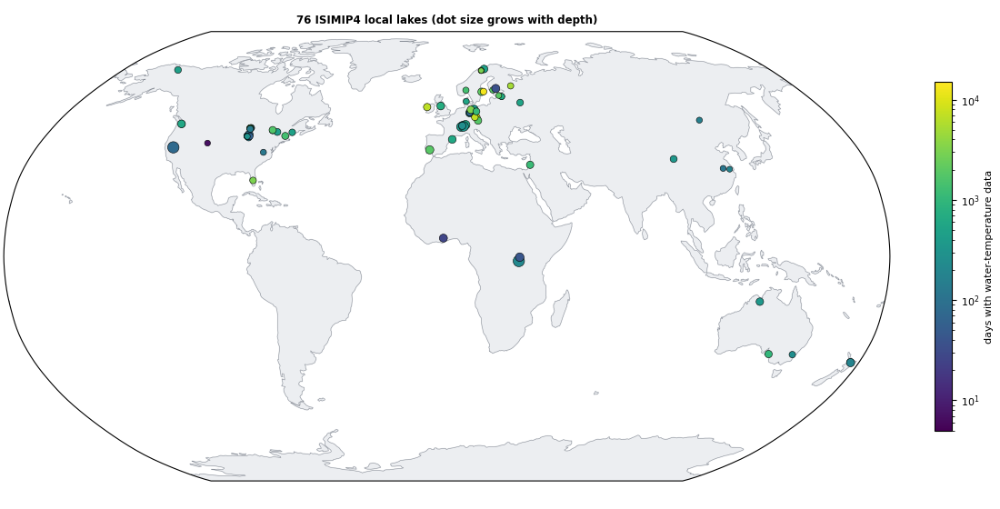
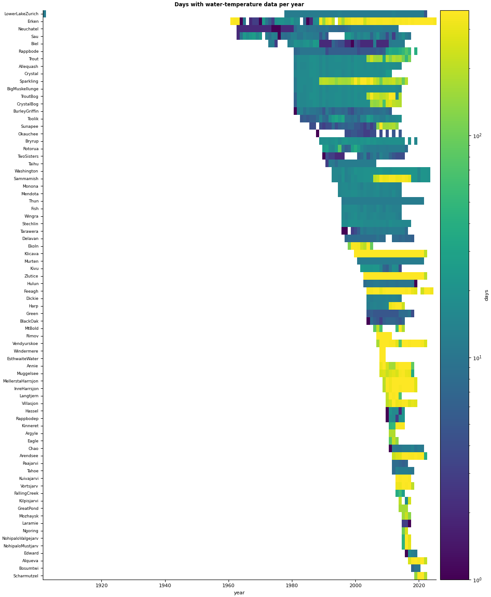

# ISIMIP4 Local Lakes: observed water temperature and bathymetry

Observed **water-temperature profiles** and **hypsometry** (depth vs area) of the **76 local lakes** of the
ISIMIP4 lake sector (`lakes_local`), for calibrating and evaluating lake models. This is the successor of the
ISIMIP3 database [icra/ISIMIP_Local_Lakes](https://github.com/icra/ISIMIP_Local_Lakes): the same lakes plus
the lakes and data contributed for ISIMIP4, in one consistent format, with every error found in the ISIMIP3
files corrected, every correction documented, and per-lake figures and metadata.



| | |
|---|---|
| Lakes | 76 (73 ISIMIP3 lakes, minus the duplicate "Zurich" folder, plus Edward, Inre Harrsjön, Mellersta Harrsjön, Villasjön; Grossglienickersee pending, see below) |
| Water temperature | 2.1 million daily values on 110,671 lake-days, 1902-2025; 27.7 million sub-daily records for 28 lakes |
| Hypsometry | every lake |
| Identifiers | ISIMIP4 protocol lake-site identifiers (`lake_site`), as used in ISIMIP output file names |
| Coordination | ISIMIP lake sector, https://www.isimip.org |

## What is new compared with ISIMIP3

- **One format for every lake**: the same file names and columns everywhere (in ISIMIP3, 10 lakes had files
  named differently from the rest, 9 had different column headers, and one header lacked a column).
- **A daily file for every lake**: 19 lakes had only sub-daily files; their daily means are now included.
- **ISIMIP4 data added**: new lakes (Lake Edward; Inre Harrsjön, Mellersta Harrsjön and Villasjön in Sweden) and
  longer records for Erken (to 2025), Feeagh (to 2024), Harp, Lower Lake Zurich (to 2022), Sammamish and
  Washington (to 2023) and Vendyurskoe (to 2022).
- **Errors corrected**, among them: an inverted hypsometry (Taihu); Rappbode reservoir profiles filed under the
  Rappbode pre-dam; Lower Lake Zurich data hidden in a "Zurich" folder with shifted columns; depths typed as
  temperatures (Bosumtwi); loggers frozen into the ice (down to −22 °C); missing-value codes (−9999) left as
  data; six-digit dates; empty files. Full list: [docs/CORRECTIONS.md](docs/CORRECTIONS.md).
- **Quality flags** for values that look wrong but are kept (density inversions, outliers).
- **Metadata** for every lake in one table, with the record, the sources used and checksums of every source file.
- **Open problems listed** for the data providers: [docs/ISSUES.md](docs/ISSUES.md) (for example Trout Lake's
  hypsometry areas are about ten times too large, and Windermere's hypsometry is of the South Basin only).

## Quick start

```python
import pandas as pd
d = pd.read_csv("LocalLakes/Erken/erken_watertemp_daily.csv", dtype={"TIMESTAMP": str})
d["date"] = pd.to_datetime(d.TIMESTAMP, format="%Y%m%d")
d = d[d.QC.isna()]                                   # leave out flagged values
h = pd.read_csv("LocalLakes/Erken/erken_hypsometry.csv")
s = pd.read_csv("LocalLakes/Erken/erken_watertemp_subdaily_2010.csv.gz", dtype={"TIMESTAMP_START": str})
```

```r
d <- read.csv("LocalLakes/Erken/erken_watertemp_daily.csv", colClasses = c(TIMESTAMP = "character"))
d$date <- as.Date(d$TIMESTAMP, "%Y%m%d")
s <- read.csv(gzfile("LocalLakes/Erken/erken_watertemp_subdaily_2010.csv.gz"))
```

## Lakes

The full table (identifiers, location, depth, record, sources and a figure per lake) is in
[docs/LAKES.md](docs/LAKES.md); all metadata are in [`metadata/lakes.csv`](metadata/lakes.csv); the data
providers and references to cite are in [docs/PROVIDERS.md](docs/PROVIDERS.md).



## Files

```
LocalLakes/<Folder>/<site>_watertemp_daily.csv
LocalLakes/<Folder>/<site>_watertemp_subdaily_<yyyy>.csv.gz     (28 lakes)
LocalLakes/<Folder>/<site>_hypsometry.csv
metadata/lakes.csv            one row per lake
metadata/source_files.csv     every source file used, with its SHA-256 checksum, rows read and used
metadata/corrections.csv      every correction: lake, source file, rule, number of values, details
metadata/checks.csv           results of scripts/check_obsdata.py
figures/                      overview map, data coverage, one figure per lake (figures/lakes/<site>.png)
docs/                         LAKES, PROVIDERS, CORRECTIONS, CORRECTIONS_BY_LAKE, ISSUES
scripts/                      the code that builds, checks and plots everything (below)
```

`<Folder>` is the lake's ISIMIP3 folder name (e.g. `LowerLakeZurich`), `<site>` its ISIMIP4 protocol lake-site
identifier (e.g. `lower-zurich`), the name used in ISIMIP output files.

### Daily water temperature: `<site>_watertemp_daily.csv`

| Column | Meaning |
|---|---|
| `SITE_ID` | provider's site code, `<ISO country code>-<lake code>` (e.g. `SE-Erk`) |
| `SITE_NAME` | lake folder name |
| `TIMESTAMP` | day, `YYYYMMDD` |
| `DEPTH` | m below the water surface (positive down), as measured |
| `WATERTEMP` | water temperature, °C; the mean of all values of that day at that depth |
| `N` | number of values averaged (1 for a single profile; up to 144 for 10-minute loggers) |
| `SOURCE` | `ISIMIP3 daily`, `ISIMIP3 sub-daily (daily mean)`, `ISIMIP4 delivery`, `ISIMIP4 delivery (daily mean of sub-daily)` |
| `QC` | empty, `unstable` and/or `outlier` (value kept; see [docs/CORRECTIONS.md](docs/CORRECTIONS.md#3-quality-flags-values-kept)) |

Each day comes from one source only (the highest-priority source with data that day: ISIMIP4 delivery,
then ISIMIP3 daily files, then daily means of ISIMIP3 sub-daily files), so a profile never mixes instruments.

### Sub-daily water temperature: `<site>_watertemp_subdaily_<yyyy>.csv.gz`

Gzip-compressed CSV, one file per calendar year; read directly by R (`gzfile`) and pandas.

| Column | Meaning |
|---|---|
| `SITE_ID`, `SITE_NAME` | as above |
| `TIMESTAMP_START`, `TIMESTAMP_END` | measurement interval, `YYYYMMDDhhmm`, in the time of the source files (time zone not documented) |
| `DEPTH` | m below the water surface |
| `WATERTEMP` | °C |

### Hypsometry: `<site>_hypsometry.csv`

| Column | Meaning |
|---|---|
| `SITE_ID`, `SITE_NAME` | as above |
| `DEPTH` | m below the water surface (0 = surface), increasing |
| `BATHYMETRY_AREA` | horizontal area of the lake at that depth, m² (decreasing with depth) |

Missing values are not written: every row holds a measured value.

### `metadata/lakes.csv`

Identifiers (`lake_folder`, `lake_site`, `site_id`, `name`), `type`, `country`, `lat`, `lon` (protocol values;
Bosumtwi corrected, `coord_note`); from the coordination sheet: `elevation_m`, `mean_depth_m`, `max_depth_m`,
`area_km2`, `watershed_area_km2`, `trophic_state`, `human_impacts`, `secchi_m`, `light_extinction_m-1`,
`institute`, `reference`; computed from the files: `temp_first`, `temp_last`, `temp_days`, `temp_values_daily`,
`temp_depths`, `temp_depth_min`, `temp_depth_max`, `subdaily_years`, `hypsometry_levels`,
`hypsometry_depth_max`, `hypsometry_area_surface_m2`, `hypsometry_source`, `temp_sources`, `qc_unstable`,
`qc_outlier`; `included` and `note` for lakes not (yet) published.

## How the database is built

```bash
python3 scripts/audit_sources.py   <ISIMIP3 LocalLakes> <ISIMIP4 LocalLakes> <work dir>   # inventory of the sources
python3 scripts/build_obsdata.py   --isimip3 <ISIMIP3 LocalLakes> --isimip4 <ISIMIP4 LocalLakes> \
        --sheet <coordination sheet as CSV> --protocol <isimip-protocol-4 lake_site.yaml> --out .
python3 scripts/check_obsdata.py   .     # format and plausibility checks -> metadata/checks.csv
python3 scripts/plot_obsdata.py    .     # figures/
python3 scripts/make_docs.py       .     # docs/LAKES.md, PROVIDERS.md, CORRECTIONS_BY_LAKE.md
```

Sources: the ISIMIP3 database (commit `1868644`), the ISIMIP4 contributions collected by the lake sector in
2026, the ISIMIP4 local-lakes coordination sheet (metadata and data-sharing permission) and the ISIMIP4
protocol ([isimip-protocol-4](https://github.com/ISI-MIP/isimip-protocol-4), `lake_site` definitions).
Python 3 with numpy, pandas, PyYAML, matplotlib and cartopy.

## Lakes not included (yet)

- **Grossglienickersee** (Germany): the data-sharing question in the coordination sheet is unanswered.
- **Bosumtwi**: the ISIMIP4 contribution is restricted to the ISIMIP lake-sector modellers; the lake is included
  with its public ISIMIP3 data.

## Using the data

Please cite the data providers' references ([docs/PROVIDERS.md](docs/PROVIDERS.md)) and this repository when you
use the data. Licence: see [LICENSE](LICENSE).

Contact: ISIMIP lake sector coordination, Daniel Mercado-Bettín (Spanish National Research Council, CSIC,
Centre for Advanced Studies of Blanes, CEAB), daniel.mercado@csic.es. Corrections and new data are welcome as
issues or pull requests.
